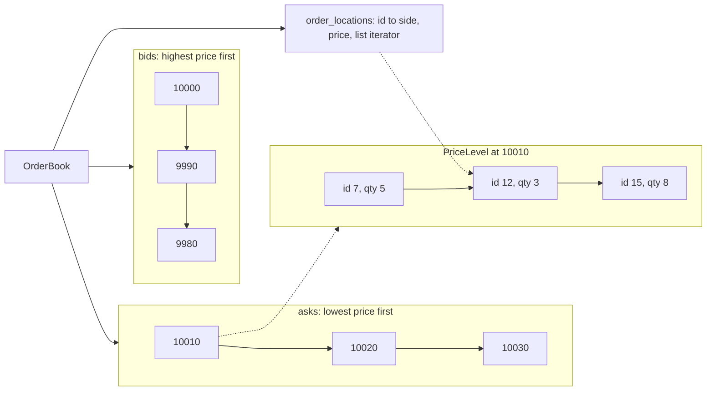
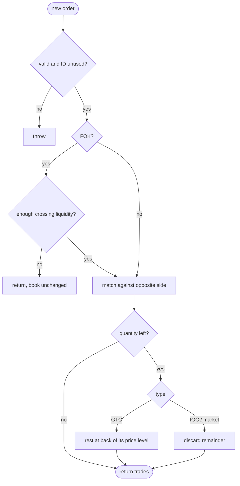
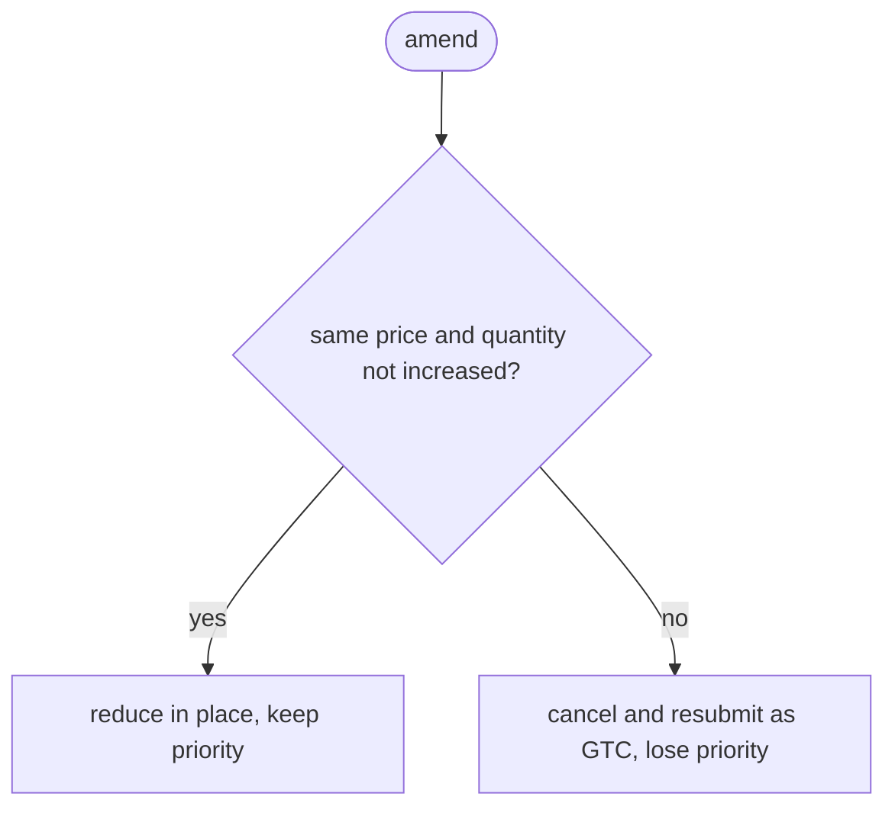

# C++ Order Book from Scratch

A small, correctness-first matching engine written in C++20.

I built this project to understand what an order book actually does beneath the
API: how price-time priority works, when an order should rest, how partial fills
change state, and which amendments should lose queue position. The code stays
deliberately compact so those decisions remain visible. This is a learning
project, not a claim that a few `std::map`s are ready to run an exchange.

## What V1 supports

- One instrument, one thread, and in-memory state
- Integer prices and quantities
- Bid and ask ladders ordered by best price
- FIFO priority within each price level
- Limit and market orders
- GTC, IOC, and FOK limit orders
- Partial fills across multiple price levels
- Cancellation by order ID
- Price and remaining-quantity amendments
- Trades reported with maker ID, taker ID, price, and quantity
- CMake builds and focused tests

V1 is feature-complete for this scope.

## Design



The price maps make the best bid and ask available at `begin()`. A linked list
inside each level provides stable iterators and constant-time removal once an
order is found. Each level also keeps its total quantity, so FOK checks don't
have to walk the list. The location hash map avoids scanning the book during
cancel or amend operations.

## Submitting an order



Matching always takes the best opposite level first and fills the order at the
front of that level. It keeps going until the incoming order is filled, the
book side is empty, or the next level no longer crosses the limit price. Empty
levels are erased as soon as their last order is filled.

For example, with asks of 3 and 2 at 10010 and 6 at 10020, a GTC buy for 10 at
10020 trades 3 and 2 at 10010, then 5 at 10020. The order at 10020 keeps its
place with 1 left, and nothing rests on the bid side.

## Amending an order



`new_quantity` in `amend_order` means the order's new remaining quantity, not
its original submitted quantity.

## Matching rules

The implementation makes a few policies explicit:

- A trade executes at the resting maker order's price.
- A buy limit crosses asks priced at or below its limit.
- A sell limit crosses bids priced at or above its limit.
- GTC rests any remainder; IOC discards it.
- FOK checks all eligible liquidity before making any change.
- Market orders consume the best available prices and never rest.
- Reducing quantity at the same price keeps priority.
- Increasing quantity or changing price performs cancel-and-replace, so the
  order loses priority. A new price may cross and generate trades immediately.
- Order IDs must be unique while active. An ID can be reused after its order is
  filled or cancelled.

The implementation favors clarity over production optimizations. V2 can
experiment with flatter containers, memory pools, event replay, execution
reports, and profiling after the behavior is firmly understood.

## Build and test

Requirements:

- A C++20 compiler
- CMake 3.20 or newer

From the repository root:

```sh
cmake -S v1 -B v1/build
cmake --build v1/build --config Debug
ctest --test-dir v1/build -C Debug --output-on-failure
```

The build enables `/W4 /permissive-` on MSVC and
`-Wall -Wextra -Wpedantic` on GCC or Clang.

## Small example

```cpp
#include "orderbook.hpp"

OrderBook book;

book.submit_limit_order(
    1, Side::sell, 10'100, 8, TimeInForce::gtc);

const auto trades = book.submit_market_order(
    2, Side::buy, 3);

// Order 1 now has 5 remaining. A reduction keeps its queue position.
book.amend_order(1, 10'100, 4);

const bool cancelled = book.cancel_order(1);
```

Prices are integers by design. An application can interpret `10'100` as cents,
ticks, or another fixed unit without introducing floating-point comparisons into
the matching engine.

## Project layout

```text
v1/
├── include/    Public types and order-book interfaces
├── src/        Matching and price-level implementation
├── tests/      Standalone correctness tests
└── CMakeLists.txt
```

The tests cover FIFO behavior, partial and multi-level fills, all time-in-force
policies, cancellation, amendment priority, market orders, invalid requests,
and aggregate price-level quantities.

## Intentional V1 limitations

There is no networking, persistence, concurrency, decimal price type,
instrument routing, self-trade prevention, risk checking, or exchange-style
execution-report stream. Those are useful future topics, but adding them here
would hide the matching rules that V1 is meant to teach.
