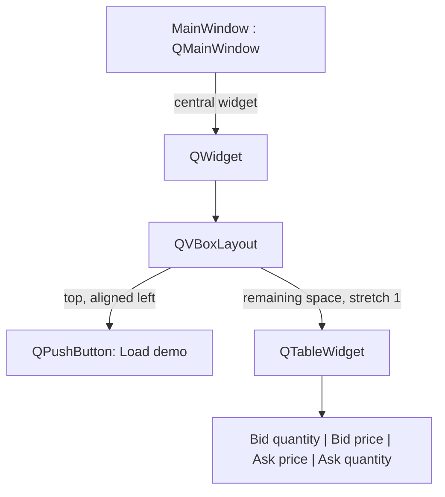
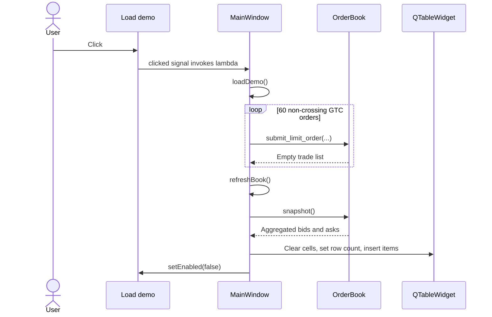

# UI overview

The terminal uses **Qt 6 Widgets**, built with CMake. **Qt Creator** is an optional
IDE for editing, building, and running it. Widgets are created directly in C++;
there are no Qt Designer `.ui` files.

## Files and startup

| File | Responsibility |
| --- | --- |
| `CMakeLists.txt` | Builds the executable and links Qt Widgets and the local engine. |
| `src/main.cpp` | Creates `QApplication`, shows `MainWindow`, and starts the event loop. |
| `src/ui/MainWindow.h` | Declares the window, its engine, table pointer, and methods. |
| `src/ui/MainWindow.cpp` | Creates widgets, connects the demo button, and renders snapshots. |
| `src/engine/` | Local copy of the matching engine; independent of Qt. Original `../v1` stays untouched. |

`QApplication` must exist before widgets. `window.show()` makes the window
visible; `app.exec()` processes clicks, redraws, and other events until exit.

## Window and layout

There is one application window. `MainWindow` inherits from `QMainWindow` and
installs a central `QWidget` containing a vertical layout.



The layout positions and resizes the widgets. The central widget becomes the
parent of the button and table, so Qt deletes them when the window is destroyed.
The table also owns its `QTableWidgetItem` cells. `book_` is a regular C++ member
owned directly by `MainWindow`.

## From a click to displayed liquidity

`connect()` binds the button's `clicked` signal to a lambda. The lambda loads the
demo and disables the button. All work runs on the UI thread; there is no timer.



The demo uses random seed `42`, ten levels per side, and three orders per level.
All orders go through the engine. They do not cross, so loading generates no
executions. Startup shows an empty book.

`snapshot()` copies prices and total quantities without exposing private order
queues. Bids arrive highest first; asks arrive lowest first. Prices remain
integer ticks in the engine; `formatPrice()` displays `10010` as `100.10` using
integer arithmetic. `refreshBook()` is also called once during construction.

## Build and run

In Qt Creator, open `v2.1/CMakeLists.txt`, select a desktop kit with Qt 6 and a
C++20 compiler, then build and run `orderbook_terminal`.

Alternatively, from the repository root:

```bash
cmake -S v2.1 -B v2.1/build
cmake --build v2.1/build -j
./v2.1/build/orderbook_terminal
```

For the graphics warnings encountered in WSL, launch with:

```bash
QT_QPA_PLATFORM=xcb LIBGL_ALWAYS_SOFTWARE=1 ./v2.1/build/orderbook_terminal
```

Currently implemented: depth table and one-shot demo loading. Order entry,
trade tape, market statistics, order status, and dark styling are still pending.
