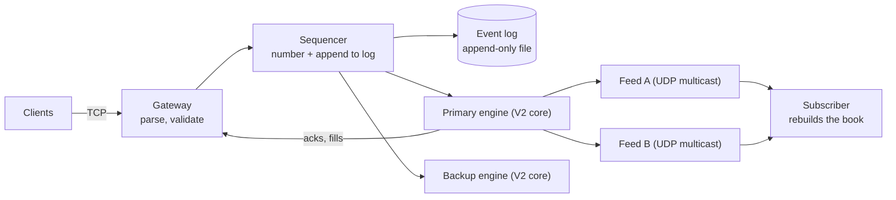
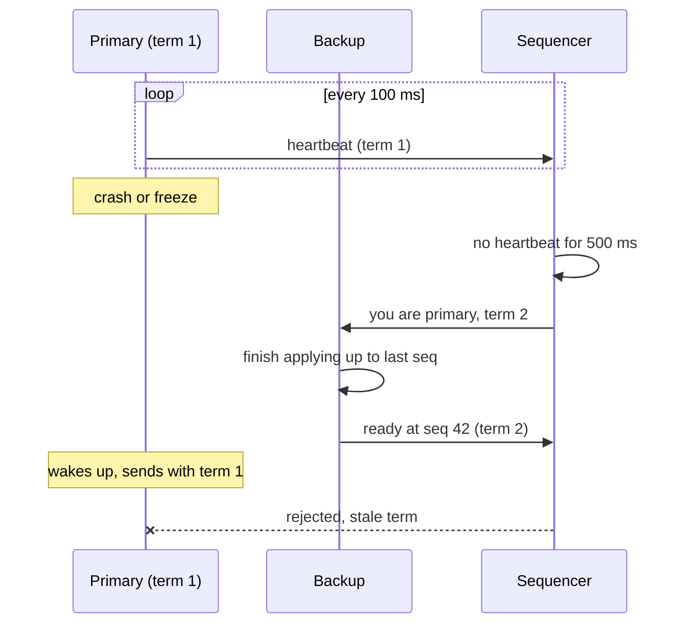
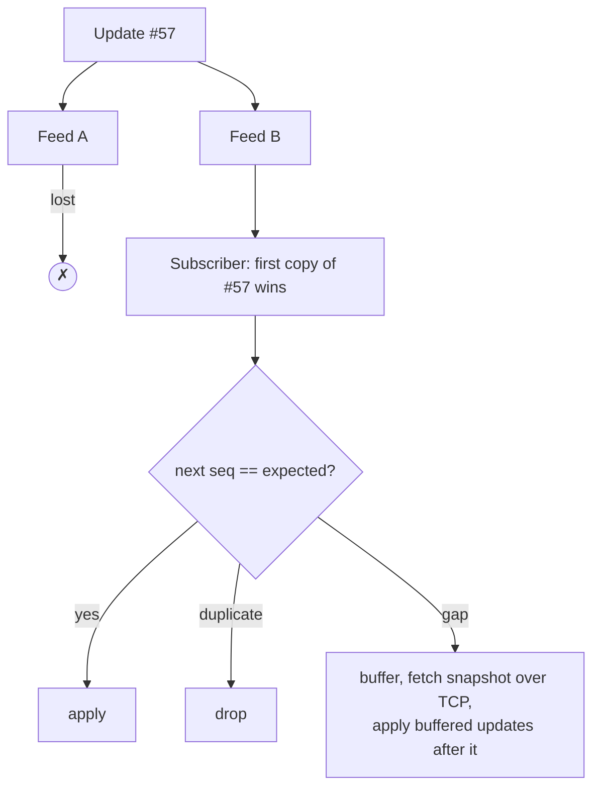
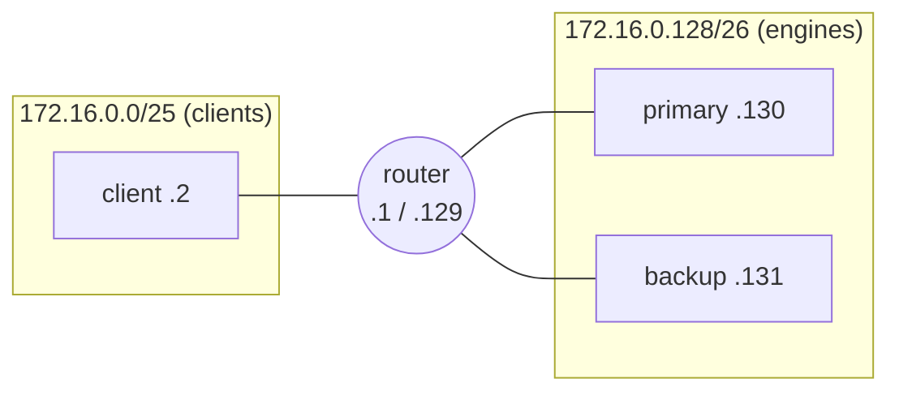

# V2: fast, then distributed

V1 is a correct, single-threaded, single-instrument matching engine. It is
**frozen**. It is the spec: V2 is correct exactly when it does what V1 does.

V2 has two goals, in this order:

1. **Fast.** Make the matching core much faster, and prove it with numbers.
2. **Distributed.** Wrap the core in a network, a log, replication and
   failover, without changing a single matching rule.

The guiding rules:

- **No optimization without a measurement.** Every change comes with a before
  and after number.
- **No feature without a test that would catch it breaking.**
- **The simplest thing that works, then iterate.** One machine, one instrument,
  one process per role. Every step ends in something you can run.

---

## 0. Before anything: make V1 a usable reference

Everything below depends on one property: **determinism**. The same input
sequence must always produce byte-identical output. Check this first:

- [ ] No wall-clock time inside matching. Timestamps come *in* with the order
      (later, the sequencer stamps them).
- [ ] No output order that depends on `unordered_map` iteration, pointer values
      or hashing.
- [ ] Define one canonical output: a text or binary **event stream** (accepts,
      fills, cancels, rejects), one event per line. Every later test compares
      these streams.
- [ ] Test: run the same 1M-order file twice and `diff` the outputs. They must
      be identical.

If this fails, fix it in V1 now. This is the only V1 change allowed.

---

## Part A: Performance

### A1. Benchmark harness (build this before touching any code)

The benchmark is a product in its own right. If it is wrong, every decision
built on it is wrong.

**Workload.** A generator with a fixed seed writes order files to disk. The
benchmark replays the file, so every run sees the same input.

| Knob | Default |
|---|---|
| Mix | 80% limit, 10% cancel, 10% market |
| Price distribution | Clustered near the mid (most real flow is within a few ticks) |
| Book depth at start | Pre-filled with N resting orders |
| Size | 10M orders |

Make the mix a parameter. Also keep a few adversarial files: many deep levels,
cancel-heavy flow, and one giant market order that sweeps the book.

**Measurement.**

- Measure matching only (orders already in memory, no I/O, no parsing). This is
  the *core* number. End-to-end numbers come later, in Part B.
- Time each order with a cheap clock (`rdtsc`, or `steady_clock` if that is
  fast enough; measure the clock's own overhead first).
- Record latencies into a histogram (HdrHistogram or a simple log-bucket
  array). Do not sort a 10M vector or print on the hot path.
- Report throughput (orders/s) and p50 / p99 / p99.9 / max.
- Warm up first, discard the warmup, then run 5+ times. Report median and
  spread. A single run proves nothing.

**Environment** (write it into every result):

- CPU model, compiler and flags (`-O2 -march=native`), commit hash.
- Pin to one core (`taskset -c 2`). Plug the laptop in. Turbo/frequency
  scaling moves results by 10-30%.
- WSL2 adds noise and may limit `perf` hardware counters. Check early what
  works; if numbers are unstable, run on bare Linux for final results.

**Deliverable:** `./bench --file flow.bin` prints one table. Results go in
`bench/results.md`, one row per commit.

### A2. Profile V1

Find where the time actually goes. Do not guess.

```sh
cmake -DCMAKE_BUILD_TYPE=RelWithDebInfo ..   # -O2 -g
perf stat -e cycles,instructions,cache-misses,branch-misses ./bench
perf record -g ./bench && perf report
# flamegraph: perf script | stackcollapse-perf.pl | flamegraph.pl > v1.svg
```

- `perf stat` says *what kind* of slow it is (cache misses? branches? just too
  many instructions?).
- `perf record` / flamegraph says *where*. A wider box means more time.
- Write down the top 3 costs. That list is the plan for A3.

Expected suspects for a `std::map` + `std::list` + `unordered_map` design:
`malloc`/`free` per order, pointer chasing through tree and list nodes, and
hashing on cancel. Confirm or disprove each one.

### A3. Optimize, one change at a time

Each change is one commit, with three things: the profile that motivated it,
the benchmark before and after, and the differential test (A4) still passing.

Candidate changes, roughly in order of expected payoff:

1. **Order pool.** Preallocate all orders in one array; free list of indices.
   No heap allocation on the hot path. (Check: `perf` shows zero `malloc`.)
2. **Intrusive FIFO per price level.** Orders hold `prev`/`next` *indices*
   (32-bit, not pointers). Cancel is O(1) with no hash lookup if the order ID
   maps directly to a pool slot.
3. **Flat price ladder.** Prices are integer ticks, so a level is
   `levels[price - base]`. Track best bid/ask; when a level empties, scan to
   the next non-empty one (or keep a bitmap and use `ctz`). Pick a bounded
   price range and reject outside it.
4. **Data layout.** Hot fields (price, qty, next) together, cold fields
   (client ID, timestamps) apart. Check with `cache-misses`.
5. **Hot path hygiene.** No virtual calls, no `std::function`, no exceptions,
   no logging. Events go into a preallocated buffer.

Stop when the profile is flat or the target is met. Not before, and not after.

**Target** (write a rough guess here before starting, compare at the end):
V1 = ___ M orders/s, p99 = ___ ns. V2 goal: 5-10x throughput, p99.9 under 1 µs
for the core.

### A4. Correctness: V2 must equal V1

- **Differential test.** Random seeded order streams go into V1 and V2. The
  event streams must be identical. Run millions of orders in CI. On a mismatch,
  shrink the input to the smallest failing case and save it as a regression
  test.
- **Invariants**, checked after every order in debug builds:
  - the book is never crossed (best bid < best ask);
  - quantity is conserved (submitted = resting + filled + cancelled);
  - every resting order is in exactly one level, in time priority.
- **Golden files.** A few hand-written scenarios with expected outputs, which
  read as documentation for the matching rules.

**Deliverable:** a README table, V1 vs V2, same machine, same file. Include
the flamegraphs before and after.

---

## Part B: Network and distribution

The matching engine is a pure function: `(book, order) -> (book, events)`.
Everything in Part B is plumbing around that function. If a matching rule
changes here, something went wrong.

### The idea in one sentence

**The log is the system.** A sequencer gives every input a number and writes
it to a log. Any engine that replays the log from the start reaches exactly the
same state. Replication, recovery and failover are all just "replay the log".



| Part | Job | Owns |
|---|---|---|
| Gateway | TCP sessions, framing, validation | Client sessions |
| Sequencer | Total order: assigns seq 1, 2, 3... and the timestamp | The log |
| Primary | Runs the core, sends acks and market data | Nothing (state = replay of log) |
| Backup | Runs the core on the same input, **stays silent** | Nothing |
| Feeds A/B | Same sequenced market data, sent twice | - |
| Subscriber | Applies the feed, detects gaps, recovers | Its own copy of the book |

Note: the sequencer is a single point of failure in this design. That is
fine for V2; write it down as a known limitation (see V3).

### B1. Binary protocol and framing

- Fixed-size, little-endian, packed structs. One header: `{len, type, seq}`.
- Messages: `NewOrder`, `Cancel`, `Ack`, `Fill`, `Reject`, `BookUpdate`,
  `Heartbeat`, `SnapshotRequest`, `Snapshot`.
- Every client order carries a **client order ID**. The gateway uses it to
  drop duplicates. This makes resending safe after a failover.
- Test: encode/decode round-trip fuzzing; split and merged TCP reads
  (a message arriving in 1-byte pieces must still parse).

### B2. TCP gateway (epoll)

- One thread, non-blocking sockets, edge-triggered `epoll`. Per-connection
  read buffer that handles partial messages.
- Validation: price in range, qty > 0, known type. Rejects never reach the
  sequencer.
- Test: 100 clients sending at once; one client sending garbage must not hurt
  the others.
- Measure: round-trip latency client -> ack on loopback. This is the first
  end-to-end number; compare with the core number from A1.

### B3. Sequencer and event log

- Assigns seq and timestamp, appends to the log (`write` to a file; measure
  the cost with and without `fsync`, and document the choice).
- **Recovery test:** kill the engine, start a new one, replay the log, compare
  the book with a snapshot taken before the kill. Must be identical. This test
  is the whole point of the design.
- Snapshots every N messages so replay does not start from zero.

### B4. Backup engine

- The backup consumes the same sequenced stream and runs the same core.
- Both engines output a hash of their state every N messages. If the hashes
  differ, crash loudly. Then determinism is checked continuously, not only in
  tests.

### B5. Heartbeat, failover and split brain



- **The sequencer decides who is primary**, not the engines themselves. Having
  one authority avoids two engines voting each other in.
- **Term numbers (fencing).** Each promotion increments the term. Every output
  carries its term. The gateway and feeds drop anything from an older term.
  A primary that was only slow cannot do harm when it comes back.
- **Clients:** after failover, clients resend unacked orders; the client order
  ID makes duplicates harmless.
- Test, the most important one in Part B: a script that kills the primary at a
  random moment during a 1M-order run. Afterwards, the event stream (minus
  dropped duplicates) must equal a run without the crash. Run it 100 times.
- Measure: time from crash to first ack from the new primary.

Heartbeat timers (100 ms / 500 ms) are starting points. Measure false
failovers under load and tune.

### B6. Market data: feeds A/B and gap recovery



- Each update carries a seq. The subscriber keeps `expected_seq`.
- Arbitration: take whichever feed delivers a seq first, drop the copy.
- Gap on both feeds: request a snapshot (book + its seq) over TCP, keep
  buffering live updates, then apply the ones newer than the snapshot.
- Test: inject random loss (`tc qdisc ... netem loss 5%` on one feed, then on
  both). The subscriber's book must always end up equal to the engine's book.
  Compare hashes.

Same pattern as RIP from the networking lab: periodic messages, a timeout that
marks the source stale, and an explicit invalid state instead of silently
using old data. If a feed has been silent for too long, the subscriber flags
its book as stale.

### B7. Practice network

Run everything on one machine with Linux network namespaces and veth pairs,
like PLT1/PLT2 in the lab:



- One script (`net/up.sh`, `net/down.sh`) creates and destroys the whole
  topology. It must be reproducible.
- Experiments, each with a number in the README:
  - Cut the primary's veth during a run, and measure the failover time.
  - Latency with 0, 1 and 2 router hops; add `netem delay` and watch p99.
  - Packet loss on the feeds, and how many snapshots it takes to recover.
- Wireshark capture plus a small Lua dissector, so messages show up as
  `NewOrder id=17 px=10050 qty=3` instead of hex.

### Build order

Each step ends with a demo and a test. Do not start the next step until the
current one's test passes.

| # | Step | Demo | Test |
|---|---|---|---|
| 0 | V1 determinism | same file -> identical output | `diff` twice |
| A1 | Benchmark | one table of numbers | stable across runs (±5%) |
| A2 | Profile | flamegraph + top 3 costs | - |
| A3 | Optimize | before/after table | differential vs V1 |
| B1 | Protocol | round-trip encode/decode | fuzz, fragmented reads |
| B2 | Gateway | `nc`-style client gets acks | 100 clients, 1 bad client |
| B3 | Sequencer + log | kill, replay, same book | recovery test |
| B4 | Backup | two engines, matching hashes | continuous hash check |
| B5 | Failover | kill primary, trading continues | 100 random kills |
| B6 | Feeds | subscriber mirrors the book | netem loss |
| B7 | Network | namespace topology | failover over a cut cable |

A1-A3 are performance engineering. B1, B2 and B7 are networking. B3-B6 are
distributed systems.

---

## Non-goals for V2

Writing these down keeps the scope honest:

- Multiple instruments, multiple sequencers, consensus (Raft/Paxos).
- Real exchange protocols (FIX, ITCH, SBE).
- Kernel bypass (DPDK), hardware timestamps, FPGA. Not possible in WSL anyway.
- Risk checks beyond basic validation.

## V3, later

- Replicate the sequencer (Raft) to remove the single point of failure.
- FIX gateway, ITCH-style feed.
- Many instruments sharded over engine processes.
- Risk gateway.
- Kernel bypass on real hardware.

## Results (fill in as you go)

| Metric | V1 | V2 |
|---|---|---|
| Core throughput (M orders/s) | | |
| Core latency p50 / p99 / p99.9 (ns) | | |
| End-to-end loopback p99 (µs) | | |
| Failover time (ms) | | |
| Feed recovery after 5% loss | | |
