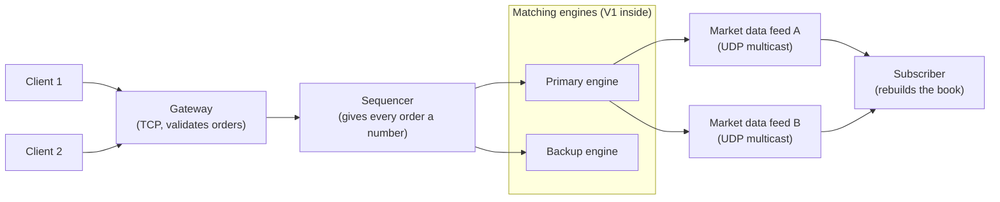
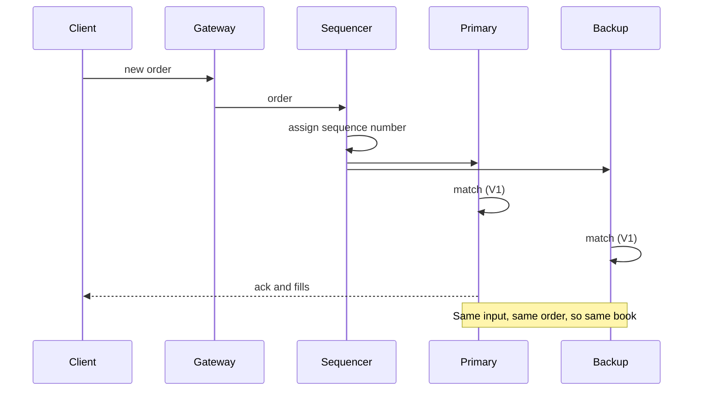
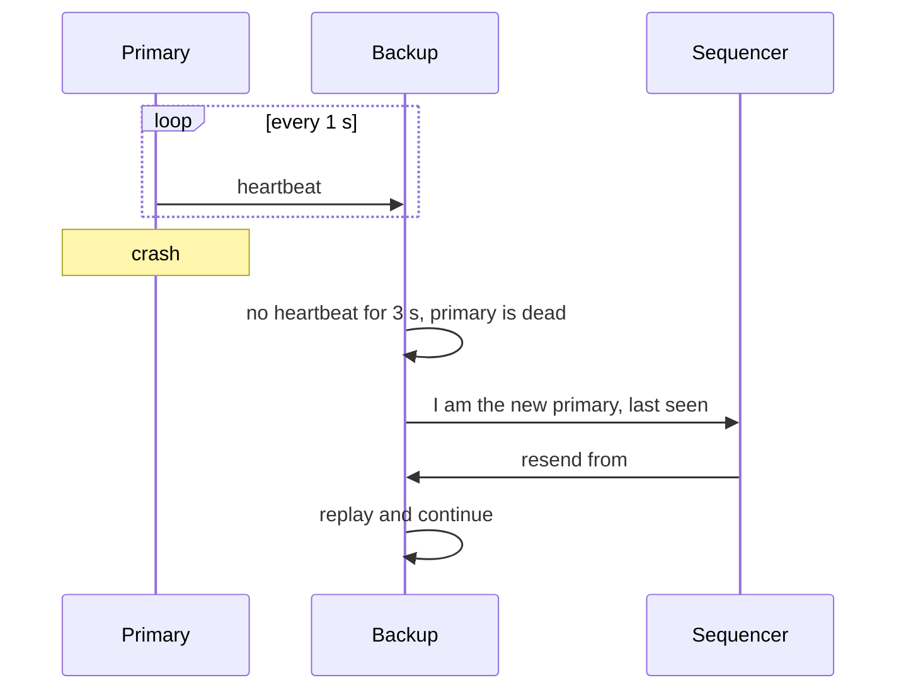
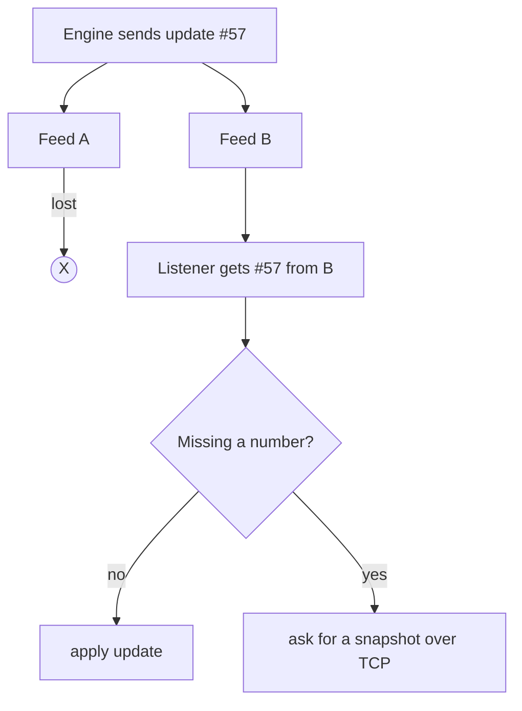
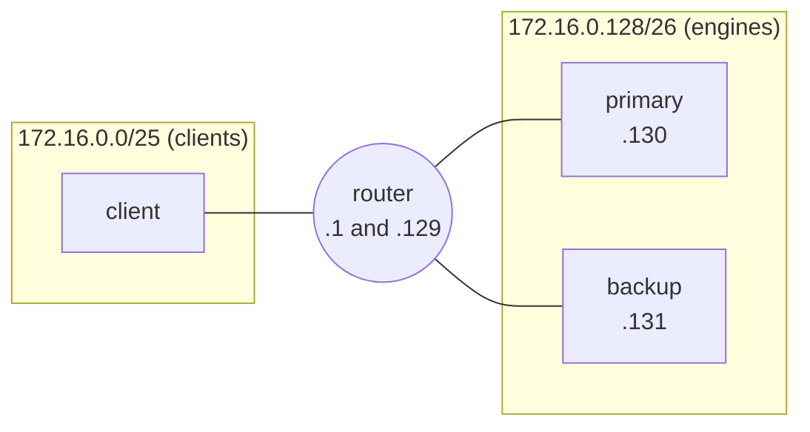
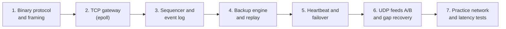

# Ideas for V2

V1 is a correct, single-threaded matching engine. V2 has two goals:

1. **Make it fast** and prove it with measurements.
2. **Make it distributed**, with networking, replication and failover.

V1 stays untouched. It is the base that everything below is built on, and it
is the reference for checking that V2 behaves the same.

---

## Part A: Performance

### 1. Benchmark harness first

We need to know V1's baseline performance before changing anything. It would
also be nice to learn how to run professional benchmarks for programs like
this one.

- Replay a fixed, synthetic order flow (for example 80% limit, 10% cancel,
  10% market).
- Report orders per second and latency at p50, p99 and p99.9.

### 1.5. Profile V1's slowest parts (perf tool)

Profiling means measuring where the program spends its time, so we optimize
the slow parts instead of guessing.

```sh
perf record -g ./benchmark   # run the program and sample it
perf report                  # table of where the time went
```

A flamegraph shows the same data as boxes: the wider the box, the more time
is spent in that function. Build with `-O2 -g` so results are realistic.

### 2. Change the data structures to tackle HFT level

Ideas, to be decided after profiling:

- Replace `std::map` with a flat, array-indexed price ladder (prices are
  integers).
- Replace `std::list` and `unordered_map` with an intrusive list and an order
  pool, so there is no heap allocation per order.

### 3. Version testing: V2 vs V1

- Feed random order streams to both versions and check they produce the same
  trades (differential testing).
- Compare benchmark numbers and put them in the README.

---

## Part B: Networking and a distributed system

V1 is the base. We do not rewrite it. We wrap it in network and replication
layers, so the matching rules stay exactly as they are.

### The big picture



| Part | Job |
|---|---|
| Gateway | Accepts TCP connections, checks messages, forwards orders |
| Sequencer | Puts all orders in one single line and numbers them 1, 2, 3... |
| Primary engine | Runs V1 and executes the orders in that order |
| Backup engine | Runs V1 too, receives the same numbered orders, ready to take over |
| Feeds A and B | Two identical streams of updates for listeners |
| Subscriber | Listens to the feed and keeps its own copy of the book |

### Why the sequencer matters (consistency)

The matching engine is **deterministic**: the same orders in the same order
always give the same trades. So if two engines receive the same numbered
orders, they end up with exactly the same book. This is called a *replicated
state machine*.



### Failover (leader election)

The primary sends a heartbeat. If the backup stops hearing it, the backup
becomes the new primary.



Hard question to cover: what if the primary is only slow, not dead, and two
engines both think they are primary? (split brain). A simple answer is a
*term number* that grows at every election, so old primaries are ignored.

### Feeds A and B (fault tolerance)

UDP can lose packets. We send the same updates twice, and the listener keeps
whichever copy arrives first.



This uses the same idea as RIP from the networking lab: periodic
announcements, timers to detect silence, and a clear "dead" marker.

| RIP (lab) | Order book |
|---|---|
| Update every 30 s | Heartbeat every 1 s |
| 180 s timeout, route invalid | No heartbeat for 3 s, feed is stale |
| 120 s garbage timer, metric 16 | Stale data stays flagged, then is dropped |

### The practice network (from the networking lab)

A fake network on one PC using Linux network namespaces and virtual cables
(veth), like the PLT1 and PLT2 routers in the lab.



Things to try: cut a virtual cable and watch the failover, compare latency
through one router and two, capture the traffic in Wireshark, and write a small
Lua dissector so Wireshark shows our messages as readable text.

### Build order



Steps 1, 2 and 7 are networking practice. Steps 3 to 6 are the distributed
systems part.

### How far it could go later (V3 ideas)

- Real protocols (FIX for orders, ITCH or SBE for market data).
- A risk gateway that rejects bad orders.
- Many instruments split over several engine processes.
- Kernel bypass (DPDK) and hardware timestamps. This is real HFT territory and
  needs special hardware, so it is out of scope in WSL.
